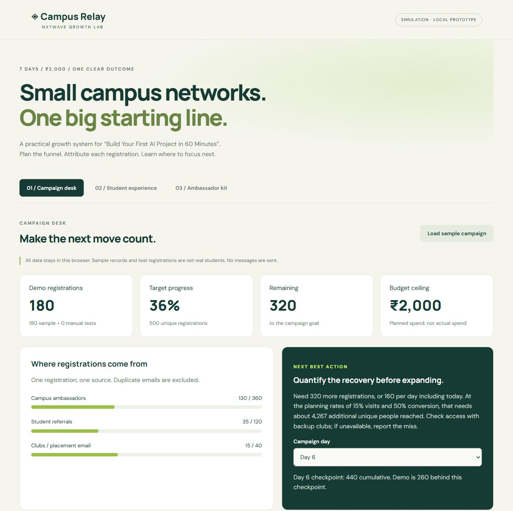

<div align="center">

# Campus Relay

### Turn campus referrals into measurable growth decisions.

A campaign desk for student acquisition: track registrations, attribute referrals, spot bottlenecks, and plan the next move.

**500 registrations · 7 days · ₹2,000 budget**

[Try the demo](#try-it-in-two-minutes) · [Growth plan](public/downloads/Growth-Plan.pdf) · [Video walkthrough](public/downloads/Campus-Relay-Walkthrough.mp4) · [AI worklog](public/downloads/AI-LEARNING-NOTES.md)

</div>



## The problem

A registration count alone cannot explain why a campaign is falling behind. Is campus distribution weak? Are visitors dropping off? Is there enough budget and reachable audience to recover?

Campus Relay brings those questions into one workflow. Built for the NxtWave Growth Challenge, it supports a proposed campaign for **“Build Your First AI Project in 60 Minutes.”**

> This is a working simulation. Records are fictional and campaign measurements are explicitly entered. No real registrations or campaign results are claimed.

## What it does

| Capability | How it helps |
| --- | --- |
| Student registration | Checks declared final-year eligibility, consent and required fields. |
| Duplicate prevention | Normalizes email addresses so capitalization cannot inflate the count. |
| Personal referral links | Generates student referral codes and attributes subsequent registrations. |
| Channel dashboard | Separates campus, referral and club/email registrations against targets. |
| Campaign check-in | Uses visits, active ambassadors and spending to recommend the next action. |
| Recovery planning | Calculates the remaining target, daily pace and estimated additional reach. |
| Funnel sensitivity | Shows how conversion assumptions change the forecast. |
| Ambassador toolkit | Creates invitation drafts with source-tracked links. |
| CSV export | Exports the ledger with escaping and spreadsheet-formula protection. |

## Try it in two minutes

```bash
git clone https://github.com/Sathvik257/Growth-AI.git
cd Growth-AI
python -m http.server 8766 --directory public
```

Open **http://localhost:8766**. No package installation, build step or API key is needed.

1. Click **Load sample campaign** to load 180 fictional registrations.
2. Select **Day 6**. See **320 remaining**, **160 per day**, and approximately **4,267 additional people reached** at the planning rates.
3. Enter **1,000 campus visits** and update the diagnosis. With 130 campus registrations, conversion becomes **13%**, triggering a conversion-repair recommendation.
4. Set **active ambassadors to 5**. The recommendation shifts to distribution coverage.
5. Register a fictional final-year student, open their referral link in the same browser profile, and register another fictional student with a different email.
6. Try a duplicate email, then export the ledger.

See the [demo guide](public/downloads/DEMO-GUIDE.md) for the full test path. A [single-file portable version](public/downloads/Campus-Relay-Portable.html) is also available; use the server if your browser restricts local-file storage.

## How the decision engine works

The engine evaluates campaign state in priority order:

| Condition | Recommendation |
| --- | --- |
| Target reached | Audit eligibility, uniqueness and attribution. |
| Budget exhausted | Stop additional spending. |
| Fewer than 12 active ambassadors from day 3 | Repair distribution coverage. |
| Missing or inconsistent visit counts | Complete measurement before making conversion claims. |
| Any measured channel converts below 35% | Inspect the weakest conversion path. |
| Behind the checkpoint on day 6 or 7 | Quantify recovery and check audience access. |
| Otherwise | Continue the permitted reminder and referral flow. |

The 35% threshold is a planning trigger, not an industry benchmark. Recovery calculations include the current day and do not assume the required audience is available.

## The growth model

| Channel | Base-case assumption | Registrations |
| --- | --- | ---: |
| Campus ambassadors | 20 ambassadors × 2 groups × 120 unique reach × 15% visits × 50% conversion | 360 |
| Student referrals | 300 existing campus/club registrants × 40% sharing × 2 new visits × 50% conversion | 120 |
| Clubs / placement email | 400 incremental people reached × 20% visits × 50% conversion | 40 |
| **Total** | **20-registration buffer above the target** | **520** |

These are testable assumptions, with overlap removed before counting reach. The downside scenario produces **296 registrations**, making early access and conversion checks essential. The [two-page plan](public/downloads/Growth-Plan.pdf) details the schedule, recruitment assumptions, ₹2,000 allocation and recovery decisions.

## Under the hood

**HTML · CSS · Vanilla JavaScript · localStorage · Node.js built-in test runner**

```text
public/
├── index.html       # Campaign desk, student flow and ambassador toolkit
├── style.css        # Responsive interface
├── app.js           # Registration, referral attribution and export
├── operations.js    # Campaign diagnosis and check-in persistence
├── assets/          # Project preview
└── downloads/       # Plan, worklog, walkthrough and portable demo
tests/
└── operations.test.cjs
vercel.json          # Static hosting configuration
```

`app.js` handles the registration workflow. `operations.js` exposes a pure `assess()` function for decision logic and connects it to the browser check-in. Records and saved check-ins persist in the current browser.

## Verification

```bash
node --test tests/operations.test.cjs
```

**Seven decision-logic tests** cover recovery math, activation, missing measurements, conversion, budget limits, the final campaign day and goal completion.

Manual browser checks cover registration, duplicate rejection, referral attribution, input validation, persistence and CSV export. Layout checks passed at **390px and 1200px**. The growth plan contains **two pages**; the walkthrough is **three minutes**.

## Deploy

Import this repository into Vercel with:

| Setting | Value |
| --- | --- |
| Framework preset | Other |
| Build command | Leave empty |
| Output directory | `public` |

The repository includes `vercel.json`. Any static host that serves `public/` can host the application.

## Scope and next steps

Data stays in one browser. Student referral validation requires the original record in that browser profile. Static hosting makes the interface accessible, but does not create cross-device tracking or a shared database.

Eligibility is self-declared; email deduplication is not identity verification. Visits and spend are manually entered. There is no real booking, message delivery or authenticated admin area. The walkthrough uses disclosed synthetic narration.

For a real campaign, the next steps are shared storage, server-side validation, verified emails, authenticated operator access and measured attribution events—followed by a small, permission-based pilot.

## Project resources

- [Growth plan — two pages](public/downloads/Growth-Plan.pdf)
- [AI worklog — three decisions and revisions](public/downloads/AI-LEARNING-NOTES.md)
- [Campaign invitation templates](public/downloads/CAMPAIGN-COPY.md)
- [Three-minute walkthrough](public/downloads/Campus-Relay-Walkthrough.mp4)
- [Walkthrough script](public/downloads/VIDEO-SCRIPT.md)
- [Downloadable project package](public/downloads/Submission-Package.zip)

Built for the NxtWave Growth Challenge. Independent project; no official affiliation claimed.
